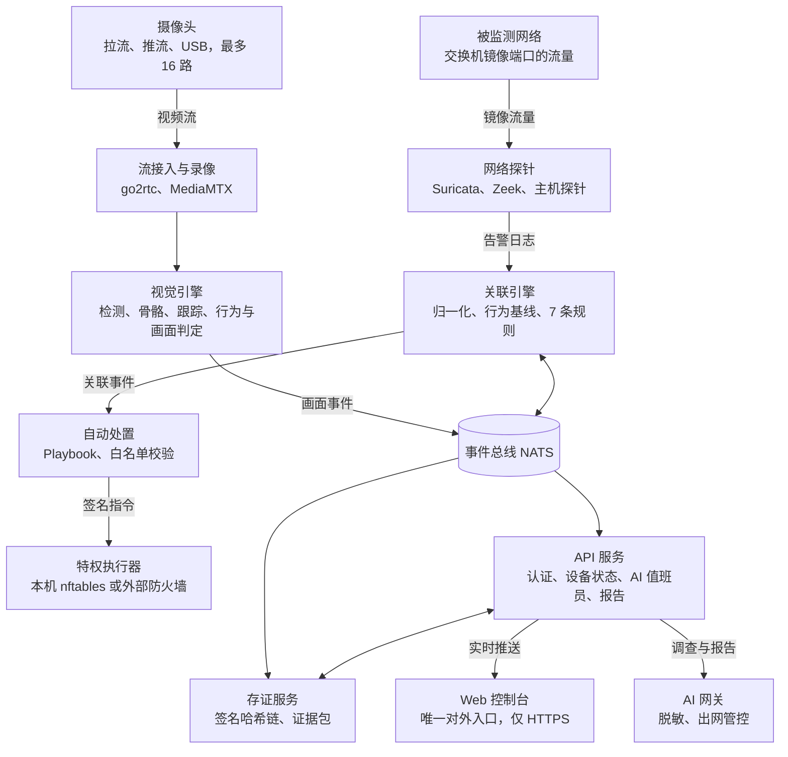

# 慧眼盾 产品介绍与解答

更新于 2026-11-18，按当前代码整理。

## 慧眼盾是什么

慧眼盾是一套边缘智能防护系统：把摄像头画面里的物理安防事件和网络流量里的攻击事件放进同一块屏，关联成同一起事件，自动处置，全程存证。

典型场景：攻击者先爆破摄像头口令，再把实时画面换成录像来掩护闯入。单看网络只是一次爆破，单看画面只是一次重放，关联起来才是一次完整的攻击。整套系统离线运行，不访问任何外部地址。

## 为什么做这个项目

摄像头本身已经成了攻击目标，而现有产品把“看画面”和“看网络”分开做，中间留下一道没人管的缝。

- **摄像头是公认的薄弱点。** 2021 年四部门集中整治摄像头偷窥问题，排查联网摄像头时发现 4 万多个漏洞，包括未授权访问和远程命令执行（[人民日报](https://paper.people.com.cn/rmrbwap/html/2021-08/10/nw.D110000renmrb_20210810_4-12.htm)）。
- **画面可以被换掉。** 2019 年 Forescout 的研究人员截下摄像头和录像机之间未加密的视频流，把实时画面换成事先录好的片段，录像机毫无察觉（[SecurityWeek](https://www.securityweek.com/researchers-replace-ip-camera-feed-fake-footage)）。
- **两类产品互不通气。** 安防平台不知道摄像头正在被爆破，安全产品不知道画面已经被换掉。

启发来自一个问题：电影里把监控换成循环录像的桥段，在真实设备上做得到。如果攻击者先拿下摄像头、再换掉画面，值班员在大屏上看到的是一切正常。慧眼盾要做的，就是把这两件事连起来看。

## 国家政策与标准

法规已经把视频系统的防攻击、防篡改写成明确义务，慧眼盾的能力正好落在这些要求上。

| 文件 | 生效时间 | 相关要求 | 慧眼盾对应的能力 |
| --- | --- | --- | --- |
| [《公共安全视频图像信息系统管理条例》](https://www.mee.gov.cn/zcwj/gwywj/202502/t20250211_1102044.shtml)（国务院令第 799 号） | 2025 年 4 月 1 日施行 | 第十五条：完善防攻击、防入侵、防病毒、防篡改、防泄露等安全技术措施，确保视频图像信息的原始完整 | 摄像头攻击检测与封禁；画面冻结和重放识别；证据哈希链 |
| [《关键信息基础设施安全保护条例》](https://www.gov.cn/gongbao/content/2021/content_5636138.htm)（国务院令第 745 号） | 2021 年 9 月 1 日施行 | 第十五条：开展网络安全监测、检测和风险评估 | 网络探针、设备行为基线、审计日志 |
| [GB/T 22239-2019 网络安全等级保护基本要求](https://www.secrss.com/articles/10700)（等保 2.0） | 2019 年 12 月 1 日实施 | 新增物联网安全扩展要求，覆盖感知节点和网关节点的设备安全 | 以摄像头为保护对象的检测与处置 |
| [GB 35114-2017 公共安全视频监控联网信息安全技术要求](https://www.sohu.com/a/273949348_653240) | 2018 年 11 月 1 日实施 | 强制性国标：设备身份认证、视频签名、视频加密 | 互补关系：国标从设备和链路加固，慧眼盾从画面内容和流量检测 |
| [《关于深入实施“人工智能+”行动的意见》](https://www.gov.cn/zhengce/zhengceku/202508/content_7037862.htm)（国发〔2025〕11 号） | 2025 年 8 月印发 | 加强人工智能在公共安全预警、社会治安管理等方面的应用；推动模型算法、应用系统等安全能力建设 | 行为识别用于安全预警；AI 结论须人工复核，判定不依赖大模型 |

这里的对应是能力方向上的，慧眼盾没有做过等保测评，也没有实现 GB 35114。另有一处差距：条例第十七条要求视频图像信息保存不少于 30 日，慧眼盾的持续录像只环形保留 1 小时，长期保存要配合录像机。

## 一个场景：凌晨两点的仓库

这是一个设想的场景，系统的每一步反应和时间都按当前代码的默认参数写。

1. **02:10 试探。** 攻击者接进仓库的网络，扫到侧门摄像头，开始逐个试弱口令。
2. **02:11 第一回合，守住了。** 一分钟内第 5 次失败，探针规则命中，攻击源被自动封禁，连接被切断。值班屏上这台摄像头变成网络告警色。
3. **02:14 对手换了打法。** 攻击者换一台机器，改成每 20 秒试一次。60 秒内不到 5 次，阈值规则不再告警。
4. **02:16 基线察觉异常。** 这台摄像头平时只有录像机来取流，现在多了一个陌生访问方，失败会话的占比连续两个窗口偏离。系统报出低速爆破，但这是模型的判断，不自动封禁，等值班员确认。
5. **02:18 口令被试出来了。** 值班员还没来得及确认，攻击者已经把实时画面换成 45 秒前的录像。大屏上侧门空无一人，一切如常。同伙向侧门走去。
6. **02:18 又过了 15 秒。** 视觉引擎发现最近 10 秒的画面变化和 45 秒前逐段吻合，判定画面重放。关联引擎把低速爆破和画面重放合并成一起最高等级的跨域事件，控制台自动弹出研判面板。
7. **02:19 一次点击。** 面板上写着命中的两条规则、攻击源地址和 AI 的调查结论。值班员点下“确认处置”，攻击源被封禁，随即通知保安赶往侧门。
8. **天亮以后。** 命中前后各 30 秒的录像和全部告警记录都在哈希链里。导出的证据包交给警方，在一台不联网的电脑上校验通过。

转折在第 5 步：单看画面，一切正常；单看网络，只是一条待确认的低速爆破。两件事连起来，才看得出有人正在进门。

## 核心能力

| 能力 | 做什么 | 关键数字 |
| --- | --- | --- |
| 行为识别 | 跌倒、攀爬、打架、长时间静止、区域入侵、越线 | 跌倒 2 秒疑似、8 秒确认 |
| 画面可信度 | 冻结、重放、遮挡、挪位、断流 | 冻结 5 秒；重放约 15 秒识别 |
| 网络检测 | 口令爆破、推流劫持、低速爆破 | 60 秒内 5 次即告警 |
| 跨域关联 | 同一设备的网络告警和画面事件合并为一起事件 | 跨域窗口 300 秒 |
| 自动处置 | 封禁攻击源 IP，先校验白名单，可一键回滚 | 30 分钟后自动解除 |
| 存证 | 事件和录像写入签名哈希链，可离线校验 | 命中前后各 30 秒录像 |
| AI 研判 | 只读调查并给出结论，不参与判定和处置 | 最多 8 轮、60 秒 |
| 三维态势 | 从画面自动生成场景，人和车实时落位 | 不需要人工标定 |

7 条关联规则，判定只由规则完成，不依赖大模型：

| 规则 | 触发条件 | 等级 | 处置 |
| --- | --- | --- | --- |
| HYD-NET-0101 认证爆破 | 规则命中的口令爆破告警 | high | 自动封禁 |
| HYD-NET-0102 推流劫持 | 向非法地址声明推流 | high | 自动封禁 |
| HYD-NET-0103 低速爆破 | 行为基线判定的失败率偏离 | high | 人工确认后封禁 |
| HYD-VIS-0001 遮挡或挪位 | 画面被遮挡、镜头被挪动 | medium | 不封禁 |
| HYD-VIS-0002 冻结或重放 | 画面定格、被换成旧录像 | medium | 不封禁 |
| HYD-VIS-0003 人员险情 | 确认的跌倒或攀爬 | medium | 不封禁 |
| HYD-X-0001 跨域 | 同一设备先被爆破或行为异常，后画面冻结或重放 | critical | 自动封禁；命中路径含模型证据时须人工确认 |

## 系统架构

画面和流量两路各自产生事件，在关联引擎汇合，再分别流向处置、存证和控制台。服务之间只经事件总线或 HTTP 通信。

## 技术栈

| 层 | 技术 |
| --- | --- |
| 后端 | Python 3.12、FastAPI、Pydantic、SQLAlchemy、PostgreSQL 16 |
| 事件总线 | NATS JetStream |
| 视觉推理 | ONNX Runtime（GPU）、OpenCV、ByteTrack |
| 视觉模型 | RTMO、RTMPose、RF-DETR、STGCN++、DINOv2、EfficientViT-Seg、MoGe-2 |
| 视频 | go2rtc、MediaMTX、WebRTC |
| 网络检测 | Suricata、Zeek、River 在线异常检测、MITRE ATT&CK |
| 处置 | nftables、Ed25519 签名指令 |
| 存证与安全 | SHA-256 哈希链、Ed25519 签名、AES-256-GCM、Argon2id |
| 大模型 | OpenAI 兼容接口，本地和云端供应商通用 |
| 前端 | React 19、TypeScript、three.js、AntV G6 |
| 部署 | Docker Compose 单机起栈，Caddy 提供 HTTPS 入口 |

## 关键实现原理

| 环节 | 怎么做的 |
| --- | --- |
| 人员检测与跟踪 | 每秒 5 帧：RF-DETR 出人车框，RTMO 与 RTMPose 出 17 点骨骼，ByteTrack 分配跟踪号 |
| 人员定位 | 取脚点像素，经地平面映射换算成平面图上的米坐标；安装高度和俯角由 MoGe-2 从单帧估出 |
| 跌倒判定 | 骨骼几何规则计时（躯干倾角不小于 60 度且髋部贴地），STGCN++ 动作模型复核 |
| 画面重放 | DINOv2 把每帧压成嵌入向量，最近 10 秒与 30～180 秒前逐段比对，连续 3 次指向同一历史时刻即判定 |
| 场景生成 | EfficientViT-Seg 分出地面、墙、家具，MoGe-2 给出三维点云，按实测尺寸生成模型 |
| 低速爆破 | 每 30 秒提取设备的 7 项会话特征，在线异常检测模型学 10 分钟基线，连续 2 个窗口偏离才告警 |
| 跨域关联 | 规则写明事件序列和时间窗口，引擎按设备缓存命中事件，按发生时刻排序后匹配 |
| 封禁 | 处置服务签发指令，特权执行器验签后把地址加入 nftables 的带超时集合，并复位已建立的连接 |
| 证据链 | 每条记录的哈希包含前一条的哈希并签名，改动一条则其后全部对不上 |
| AI 调查 | 模型每轮从 6 个只读工具中选一个查询或给出判定，输出在本地校验并回溯事实 |
| 实时推送 | 事件经 WebSocket 分频道广播；视频走 WebRTC，由 go2rtc 直达浏览器 |

## 研发中的困难与解法

项目从 2026 年 10 月 26 日建仓到 11 月 18 日共 278 次提交。最费力的不是把模型跑起来，而是模型遇到真实画面之后冒出来的问题。下表每一条都能在代码注释或提交记录里找到。

| 困难 | 当时的现象 | 怎么解决的 |
| --- | --- | --- |
| 坐着不动的人“消失” | 为省算力只推理有变化的区域，办公室俯拍画面里 4 个人只剩 1 个 | 每 10 帧整帧推理一次，漏掉的人几秒内重新检出 |
| 远处的人骨骼不准 | 整帧缩小后人只剩 50～100 像素高，脚踝可见比例只有 26%～51% | 按人员框裁剪放大再估计，脚踝可见比例升到 63% |
| 动作模型乱报 | 坐着聊天被认作打架，坐着的人被提示跌倒 | 模型只对近期站着的人起作用，打架须模型和几何条件同时成立 |
| 单目测距尺度不稳 | 同一画面换一种缩放，估出的安装高度能差 25% | 用办公桌的标准高度校正尺度，多次推理取中位数 |
| 场景里的人来回飘 | 坐着的人脚踝时隐时现，地面位置一跳就是半米 | 按头肩判断是否在动，不动时锁定位置 |
| 封禁后连接断不掉 | 只丢包时，已建立的连接仍留在两端，设备继续重传 | 对 TCP 回复复位报文，两端立即关闭 |
| 显卡静默降速 | 显卡不可用时推理库只记一条警告就改用 CPU | 启动时检查实际推理设备，回退即报错退出 |
| 演示偶尔失灵 | 上一轮攻击的余波先拼出一起跨域事件，压下本轮的，10 轮里出现 1 轮 | 攻击前再复位一次 |
| 现场画面误报 | 桌面平拍的手机画面，遮挡、挪位、冻结、重放 3 小时合计误报约百次 | 还没有根治，演示时用演示静默屏蔽 |

## 控制台

| 页面 | 内容 |
| --- | --- |
| 监控墙 | 各路实时画面，叠加人员框、骨骼和跟踪号；顶部是在线设备、活跃告警等关键指标 |
| 态势 | 三维场景，人和车实时移动，从攻击源到设备画出攻击连线 |
| 告警与详情 | 关联事件置顶；可回放录像、确认处置、立即解封、生成报告、导出证据包 |
| 事件研判 | 规则命中、自动处置、AI 调查、结论四个阶段，逐步列出 AI 的每次查询 |
| 关系图 | 以一台设备为中心，展示攻击源、攻击类型、关联事件和处置之间的关系 |
| 管理 | 摄像头接入（拉流、推流、USB 自动发现）、场景搭建、模型供应商配置 |

四种角色：viewer 只能查看，operator 可以处置，admin 可以管理，auditor 读审计日志。

## 演示与运行

首次运行先 `make fetch-models` 下载模型、`make demo-media` 生成演示素材，再 `make demo-up` 启动（无显卡加 `GPU=0`），浏览器访问 `https://127.0.0.1`。

| 命令 | 作用 |
| --- | --- |
| `make attack-show` | 分步攻击演示：锁定目标、弱口令爆破、画面重放，约 23 秒 |
| `make demo-reset` | 解除封禁、恢复画面，可立即重演 |
| `make demo-quiet` | 演示静默：屏蔽现场摄像头的易误报事件，`make demo-normal` 恢复 |

攻击演示只针对仓库自建的靶机。现场演示的话术见 `demo/演示脚本-3人.md` 与 `demo/演示脚本-4人.md`。

## 常见问题解答

| 问题 | 回答 |
| --- | --- |
| 和普通监控、入侵检测有什么不同？ | 把两者的告警按设备和时间关联：同一台摄像头先被爆破、后画面被重放，合并成一起最高等级的跨域事件 |
| 自动封禁会不会封错？ | 执行前校验白名单；含模型证据时须人工确认；30 分钟自动解除；可一键解封，每步记入审计 |
| 大模型判断错了会误封吗？ | 不会。大模型只做只读调查和写报告，判定和处置只由规则与 Playbook 决定 |
| 数据会不会发到外网？ | 默认离线。可以全局禁止公网模型供应商；调用公网供应商前，内网地址和设备编号先换成假名 |
| 模型不可用怎么办？ | 按顺序故障转移；全部不可用时退回规则结论和模板报告，判定和处置不受影响 |
| 证据怎么证明没被改过？ | 记录进哈希链并签名，导出的证据包用独立的离线工具 `hyd-evidence verify` 校验 |
| 做人脸识别吗？ | 不做。不用人脸、ReID 和属性识别模型，不输出人员裁剪图 |
| 需要人工标定摄像头吗？ | 不是必须。安装高度和俯角从画面自动估计，也可以点选 4 组地面点精确标定 |
| 没有显卡能运行吗？ | 能，以 `GPU=0` 启动改用 CPU。摄像头上限 16 路 |
| 演示里的攻击是真的吗？ | 攻击报文和封禁都真实发生，但攻击方只够得到自建靶机 |

## 与市面产品对比

现有产品各占一头：视频平台只看画面，视频专网安全产品只看网络。慧眼盾的差异是把两头关联成同一起事件，代价是规模和功能面都小得多。下表依据各产品的公开网页，没有实测。

| 类别 | 代表产品 | 它们强在哪 | 公开资料里没有的 |
| --- | --- | --- | --- |
| 视频安防管理平台 | [海康 HikCentral Professional](https://technode.global/prnasia/hikvision-launches-hikcentral-professional-v3-0-with-an-upgraded-clustering-architecture/) | 单台服务器 2 万路视频，集群 5 万路，主备热备，门禁等子系统齐全 | 针对摄像头的网络攻击检测 |
| 视频专网安全产品 | [新华三视频安全网关](https://www.h3c.com/cn/d_202009/1345571_30007_0.htm) | 资产识别、设备指纹准入、弱口令与漏洞检测、防暴力破解 | 画面内容分析、行为识别、自动处置 |
| 开源智能录像机 | [Frigate](https://docs.frigate.video/) | 本地 AI 目标检测，按检出目标留存录像，接入智能家居 | 网络入侵检测、画面重放识别、封禁攻击源 |
| 开源网络安全监测 | [Security Onion](https://docs.securityonion.net/en/2.4/about.html) | 网络与主机可见性、日志管理、案件管理、分布式部署 | 视频分析和物理安防 |

**优势**

- **跨域关联**：网络爆破加画面重放合并成一起事件。这类攻击是真实存在的，[Forescout 在 2019 年演示过](https://www.securityweek.com/researchers-replace-ip-camera-feed-fake-footage)把摄像头画面替换成录像，录像机收到的是旧画面而不自知。
- **画面重放识别**：从画面内容本身判断，不依赖摄像头或传输链路支持加密，演示中约 15 秒识别。
- **从检测到处置的闭环**：自动封禁带白名单校验、到期解除和一键回滚，不只是告警。
- **证据可离线校验**：事件和录像进签名哈希链，第三方用独立工具就能验证。
- **离线与隐私**：整套系统不出网，大模型可以全部用本地的；不做人脸识别，判定不依赖大模型。

**不足**

- **规模**：上限 16 路、单机部署，没有集群和热备。海康的平台单台服务器就是 2 万路。
- **接入**：没有 GB/T 28181 国标接入，只支持 RTSP、RTMP、HTTP、ONVIF 拉流和推流、USB。
- **网络安全面窄**：没有资产发现、准入控制、弱口令和漏洞扫描；自研网络规则只覆盖 RTSP 爆破和推流劫持，处置只有封禁 IP。
- **算法成熟度**：7 个模型的评测指标多数还是“未评测”，打架没有真实样本，现场摄像头的画面可信度误报偏多。
- **业务面窄**：只管摄像头，没有门禁、对讲等子系统，也没有移动端应用。

## 当前边界

- 处置动作只有封禁 IP 一种。
- 登记和检测的设备只有摄像头。
- 攻击演示只能针对自建靶机。
- 现场摄像头的画面可信度判定误报偏多，演示时用演示静默屏蔽。
- 关系图、品牌标识和演示静默还在 `feat/console-review` 分支的工作区里，尚未提交。
