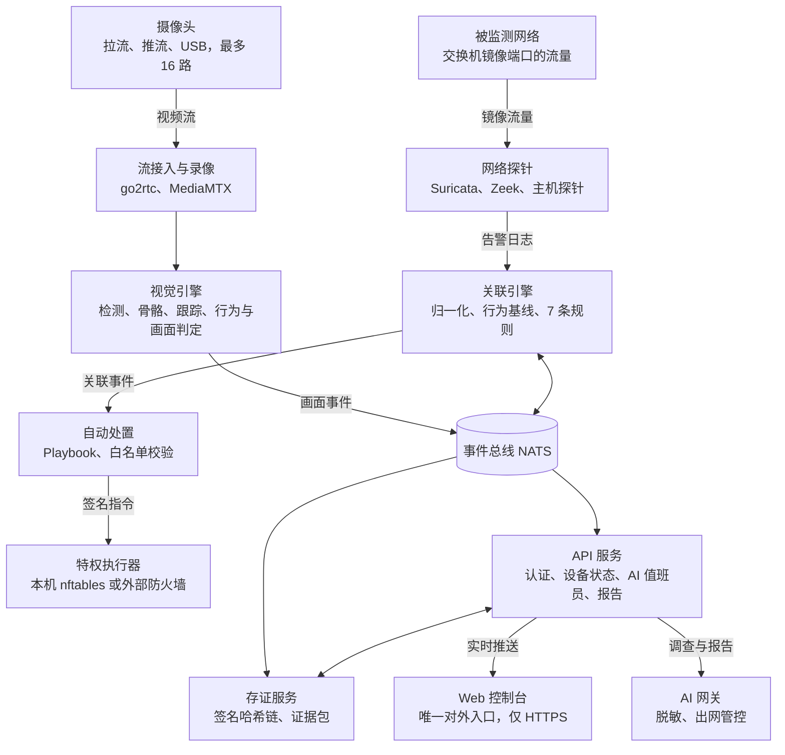

# 慧眼盾 产品介绍与解答

更新于 2026-11-18，按当前代码整理。

## 慧眼盾是什么

慧眼盾是一套边缘智能防护系统：把摄像头画面里的物理安防事件和网络流量里的攻击事件放进同一块屏，关联成同一起事件，自动处置，全程存证。

典型场景：攻击者先爆破摄像头口令，再把实时画面换成录像来掩护闯入。单看网络只是一次爆破，单看画面只是一次重放，关联起来才是一次完整的攻击。整套系统离线运行，不访问任何外部地址。

## 核心能力

| 能力 | 做什么 | 关键数字 |
| --- | --- | --- |
| 行为识别 | 跌倒、攀爬、打架、长时间静止、区域入侵、越线 | 跌倒 2 秒疑似、8 秒确认 |
| 画面可信度 | 冻结、重放、遮挡、挪位、断流 | 冻结 5 秒；重放约 15 秒识别 |
| 网络检测 | 口令爆破、推流劫持、低速爆破 | 60 秒内 5 次即告警 |
| 跨域关联 | 同一设备的网络告警和画面事件合并为一起事件 | 跨域窗口 300 秒 |
| 自动处置 | 封禁攻击源 IP，先校验白名单，可一键回滚 | 30 分钟后自动解除 |
| 存证 | 事件和录像写入签名哈希链，可离线校验 | 命中前后各 30 秒录像 |
| AI 研判 | 只读调查并给出结论，不参与判定和处置 | 最多 8 轮、60 秒 |
| 三维态势 | 从画面自动生成场景，人和车实时落位 | 不需要人工标定 |

7 条关联规则，判定只由规则完成，不依赖大模型：

| 规则 | 触发条件 | 等级 | 处置 |
| --- | --- | --- | --- |
| HYD-NET-0101 认证爆破 | 规则命中的口令爆破告警 | high | 自动封禁 |
| HYD-NET-0102 推流劫持 | 向非法地址声明推流 | high | 自动封禁 |
| HYD-NET-0103 低速爆破 | 行为基线判定的失败率偏离 | high | 人工确认后封禁 |
| HYD-VIS-0001 遮挡或挪位 | 画面被遮挡、镜头被挪动 | medium | 不封禁 |
| HYD-VIS-0002 冻结或重放 | 画面定格、被换成旧录像 | medium | 不封禁 |
| HYD-VIS-0003 人员险情 | 确认的跌倒或攀爬 | medium | 不封禁 |
| HYD-X-0001 跨域 | 同一设备先被爆破或行为异常，后画面冻结或重放 | critical | 自动封禁；命中路径含模型证据时须人工确认 |

## 系统架构

画面和流量两路各自产生事件，在关联引擎汇合，再分别流向处置、存证和控制台。服务之间只经事件总线或 HTTP 通信。

## 技术栈

| 层 | 技术 |
| --- | --- |
| 后端 | Python 3.12、FastAPI、Pydantic、SQLAlchemy、PostgreSQL 16 |
| 事件总线 | NATS JetStream |
| 视觉推理 | ONNX Runtime（GPU）、OpenCV、ByteTrack |
| 视觉模型 | RTMO、RTMPose、RF-DETR、STGCN++、DINOv2、EfficientViT-Seg、MoGe-2 |
| 视频 | go2rtc、MediaMTX、WebRTC |
| 网络检测 | Suricata、Zeek、River 在线异常检测、MITRE ATT&CK |
| 处置 | nftables、Ed25519 签名指令 |
| 存证与安全 | SHA-256 哈希链、Ed25519 签名、AES-256-GCM、Argon2id |
| 大模型 | OpenAI 兼容接口，本地和云端供应商通用 |
| 前端 | React 19、TypeScript、three.js、AntV G6 |
| 部署 | Docker Compose 单机起栈，Caddy 提供 HTTPS 入口 |

## 关键实现原理

| 环节 | 怎么做的 |
| --- | --- |
| 人员检测与跟踪 | 每秒 5 帧：RF-DETR 出人车框，RTMO 与 RTMPose 出 17 点骨骼，ByteTrack 分配跟踪号 |
| 人员定位 | 取脚点像素，经地平面映射换算成平面图上的米坐标；安装高度和俯角由 MoGe-2 从单帧估出 |
| 跌倒判定 | 骨骼几何规则计时（躯干倾角不小于 60 度且髋部贴地），STGCN++ 动作模型复核 |
| 画面重放 | DINOv2 把每帧压成嵌入向量，最近 10 秒与 30～180 秒前逐段比对，连续 3 次指向同一历史时刻即判定 |
| 场景生成 | EfficientViT-Seg 分出地面、墙、家具，MoGe-2 给出三维点云，按实测尺寸生成模型 |
| 低速爆破 | 每 30 秒提取设备的 7 项会话特征，在线异常检测模型学 10 分钟基线，连续 2 个窗口偏离才告警 |
| 跨域关联 | 规则写明事件序列和时间窗口，引擎按设备缓存命中事件，按发生时刻排序后匹配 |
| 封禁 | 处置服务签发指令，特权执行器验签后把地址加入 nftables 的带超时集合，并复位已建立的连接 |
| 证据链 | 每条记录的哈希包含前一条的哈希并签名，改动一条则其后全部对不上 |
| AI 调查 | 模型每轮从 6 个只读工具中选一个查询或给出判定，输出在本地校验并回溯事实 |
| 实时推送 | 事件经 WebSocket 分频道广播；视频走 WebRTC，由 go2rtc 直达浏览器 |

## 控制台

| 页面 | 内容 |
| --- | --- |
| 监控墙 | 各路实时画面，叠加人员框、骨骼和跟踪号；顶部是在线设备、活跃告警等关键指标 |
| 态势 | 三维场景，人和车实时移动，从攻击源到设备画出攻击连线 |
| 告警与详情 | 关联事件置顶；可回放录像、确认处置、立即解封、生成报告、导出证据包 |
| 事件研判 | 规则命中、自动处置、AI 调查、结论四个阶段，逐步列出 AI 的每次查询 |
| 关系图 | 以一台设备为中心，展示攻击源、攻击类型、关联事件和处置之间的关系 |
| 管理 | 摄像头接入（拉流、推流、USB 自动发现）、场景搭建、模型供应商配置 |

四种角色：viewer 只能查看，operator 可以处置，admin 可以管理，auditor 读审计日志。

## 演示与运行

首次运行先 `make fetch-models` 下载模型、`make demo-media` 生成演示素材，再 `make demo-up` 启动（无显卡加 `GPU=0`），浏览器访问 `https://127.0.0.1`。

| 命令 | 作用 |
| --- | --- |
| `make attack-show` | 分步攻击演示：锁定目标、弱口令爆破、画面重放，约 23 秒 |
| `make demo-reset` | 解除封禁、恢复画面，可立即重演 |
| `make demo-quiet` | 演示静默：屏蔽现场摄像头的易误报事件，`make demo-normal` 恢复 |

攻击演示只针对仓库自建的靶机。现场演示的话术见 `demo/演示脚本-3人.md` 与 `demo/演示脚本-4人.md`。

## 常见问题解答

| 问题 | 回答 |
| --- | --- |
| 和普通监控、入侵检测有什么不同？ | 把两者的告警按设备和时间关联：同一台摄像头先被爆破、后画面被重放，合并成一起最高等级的跨域事件 |
| 自动封禁会不会封错？ | 执行前校验白名单；含模型证据时须人工确认；30 分钟自动解除；可一键解封，每步记入审计 |
| 大模型判断错了会误封吗？ | 不会。大模型只做只读调查和写报告，判定和处置只由规则与 Playbook 决定 |
| 数据会不会发到外网？ | 默认离线。可以全局禁止公网模型供应商；调用公网供应商前，内网地址和设备编号先换成假名 |
| 模型不可用怎么办？ | 按顺序故障转移；全部不可用时退回规则结论和模板报告，判定和处置不受影响 |
| 证据怎么证明没被改过？ | 记录进哈希链并签名，导出的证据包用独立的离线工具 `hyd-evidence verify` 校验 |
| 做人脸识别吗？ | 不做。不用人脸、ReID 和属性识别模型，不输出人员裁剪图 |
| 需要人工标定摄像头吗？ | 不是必须。安装高度和俯角从画面自动估计，也可以点选 4 组地面点精确标定 |
| 没有显卡能运行吗？ | 能，以 `GPU=0` 启动改用 CPU。摄像头上限 16 路 |
| 演示里的攻击是真的吗？ | 攻击报文和封禁都真实发生，但攻击方只够得到自建靶机 |

## 当前边界

- 处置动作只有封禁 IP 一种。
- 登记和检测的设备只有摄像头。
- 攻击演示只能针对自建靶机。
- 现场摄像头的画面可信度判定误报偏多，演示时用演示静默屏蔽。
- 关系图、品牌标识和演示静默还在 `feat/console-review` 分支的工作区里，尚未提交。
